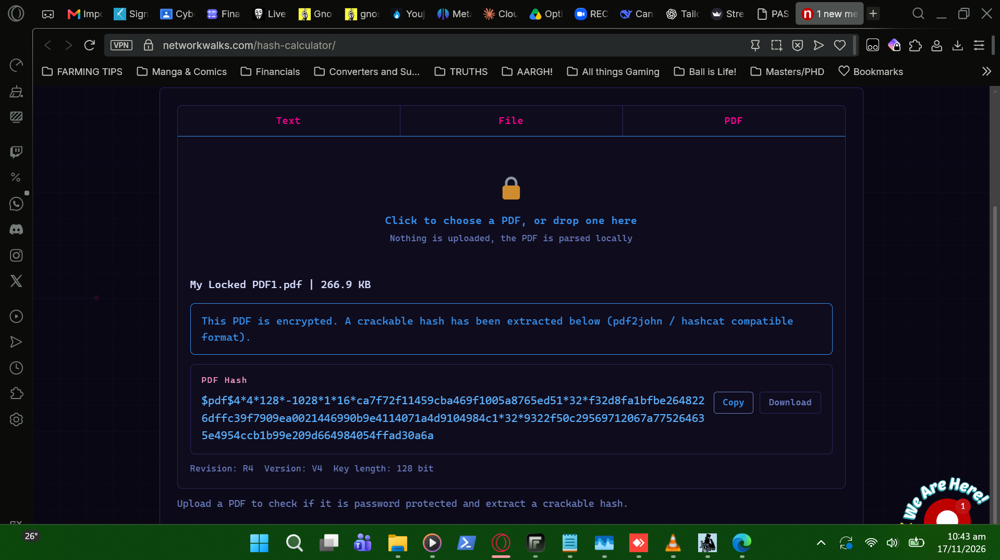
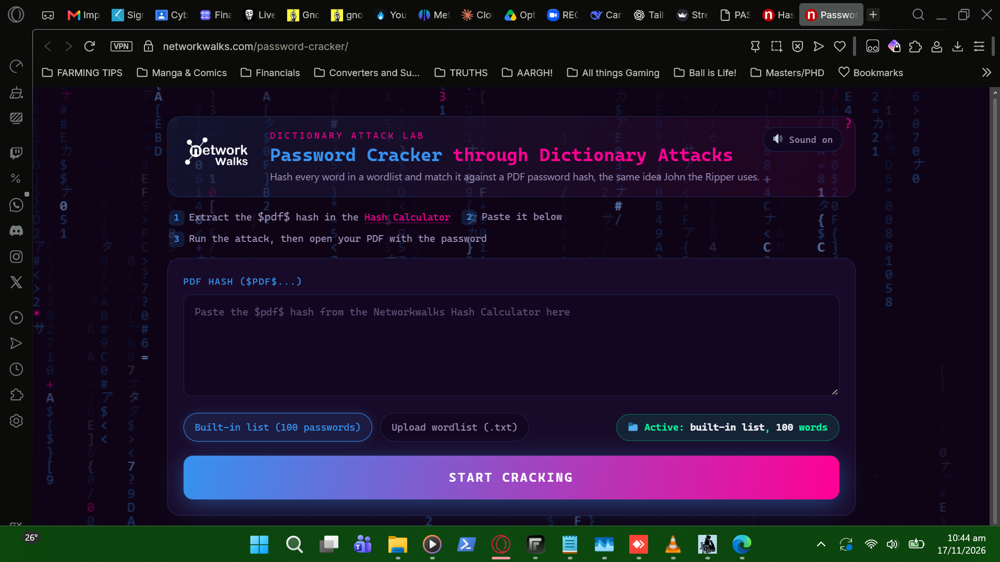
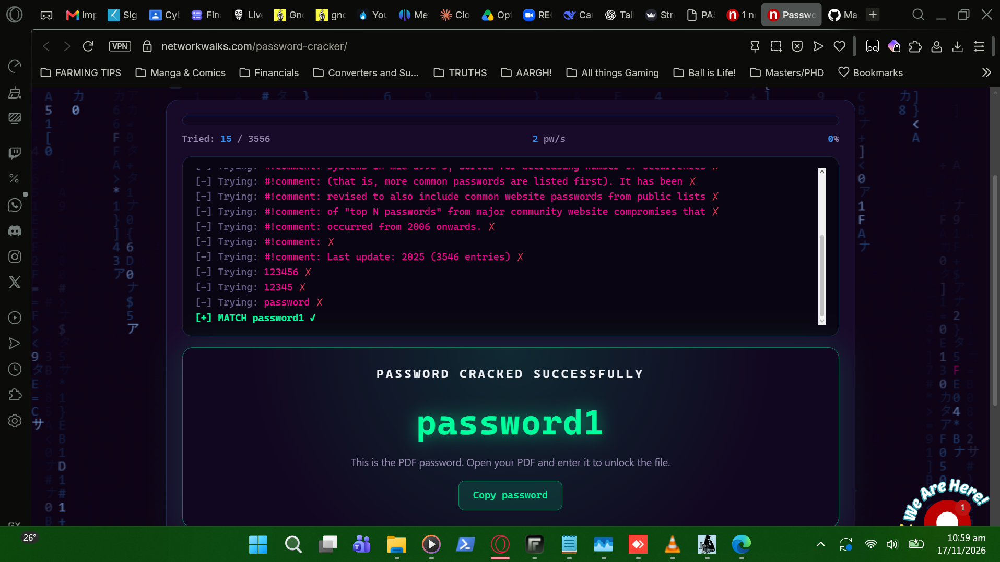
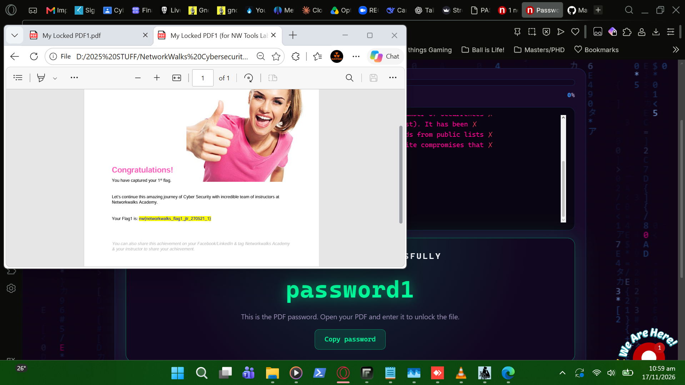

# Week 3 - Project Module 2: Password Cracking with Networkwalks Tools

## Overview
In this lab, I successfully cracked the password of a protected PDF file (`My Locked PDF1.pdf`) using two custom online tools developed by Networkwalks: the **Hash Calculator** and the **Password Cracker**. This exercise demonstrated how a dictionary attack works and proved the vulnerability of weak passwords.

## Lab Environment
* **Operating System:** Windows PC (Browser-based)
* **Tools Used:** Networkwalks Hash Calculator, Networkwalks Password Cracker
* **Target File:** `My Locked PDF1.pdf`
* **Attack Type:** Dictionary Attack (Built-in List)

## Step-by-Step Walkthrough

### Step 1: Extracting the PDF Hash
* Opened the Networkwalks Hash Calculator (https://networkwalks.com/hash-calculator/).
* Uploaded `My Locked PDF1.pdf` to the **PDF** tab.
* The tool successfully extracted the crackable `$pdf$` hash.

### Step 2: Executing the Dictionary Attack
* Copied the full hash string.
* Opened the Networkwalks Password Cracker (https://networkwalks.com/password-cracker/).
* Pasted the `$pdf$` hash into the input field.
* Selected the **Built-in list (100 passwords)** and clicked **Start Cracking**.

### Step 3: Capturing the Flag
* The dictionary attack successfully matched the hash.
* **Recovered Password:** `password1`
* Entered the password into the locked PDF to unlock it.
* **Flag:** "Congratulations! You have captured your 1st flag..."

## Screenshots
### 1. Hash Extraction using Networkwalks Hash Calculator

### 2. Dictionary Attack in Progress

### 3. Password Successfully Cracked

### 4. Unlocked PDF (The Flag)

## Key Takeaways
* **Dictionary Attacks are Fast:** By using a list of known common passwords, the tool cracked `password1` almost instantly.
* **The Danger of Predictability:** "password1" is one of the most commonly used passwords globally. Attackers know this and always try it first.
* **Defense:** Users must avoid using dictionary words with simple numbers appended. Organizations should enforce complex passwords and use Multi-Factor Authentication (MFA).
